# Warehouse Demand Forecast: How Many Pickers Next Week?

**Forecast a warehouse's daily picking workload 7 days ahead and turn it into a picker staffing plan, served as a live API and web app.**

**Live app:** https://warehouse-demand-forecast.vercel.app · **API docs:** https://warehouse-demand-api.vercel.app/docs

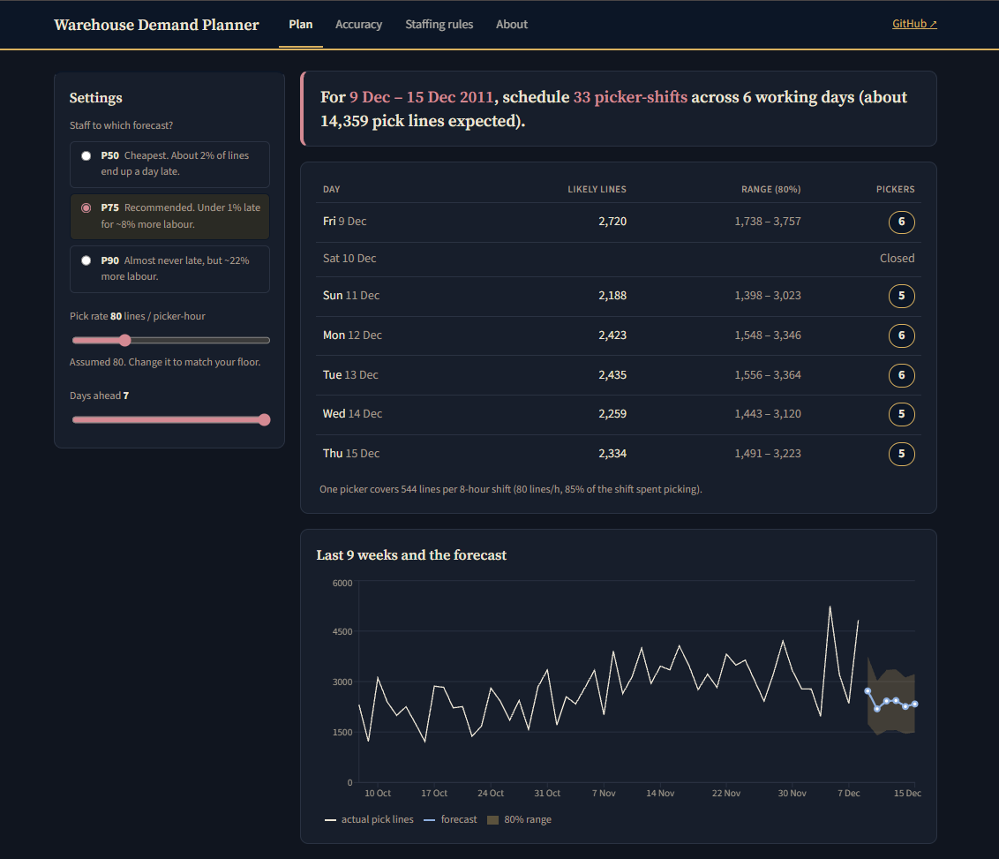

A UK online wholesaler ships every order from one warehouse. Each product line on an order is one pick, so daily **pick lines** decide how many pickers are needed. This project forecasts pick lines with LightGBM, tests staffing rules against six months of real orders, simulates the day hour by hour (SimPy, cross-checked in Arena) to choose shift times, and serves the result through a FastAPI service and a React app.

**Data:** [UCI Online Retail II](https://archive.ics.uci.edu/dataset/502/online+retail+ii): 1,067,371 order lines, 1 Dec 2009 – 9 Dec 2011 (CC BY 4.0).

---

## Results

| | Result |
|---|---|
| **Forecast error** (Jul – Dec 2011, unseen) | Daily WAPE **22.1%** vs **25.6%** for "same weekday last week" (**14% lower**); weekly totals **13.2%** |
| **Uncertainty** | The 80% range (P10 – P90) contains **80%** of test days |
| **Best staffing rule** | Staffing to the **P75** forecast: **0.9%** of lines picked late vs **6.4%** for a flat crew, for **7.7%** more labour |
| **Cheapest rule** | Staffing to **P50**: **3% cheaper** than a flat crew *and* late lines fall from 6.4% to 2.1% |
| **Shift timing (simulation)** | Same 6 pickers: **9.4%** of lines late on an 08 – 16 shift vs **1.4%** on a 09 – 17 / 11 – 19 split, at **6.5% lower** cost |
| **Next week (9 – 15 Dec 2011)** | **33 picker-shifts** over 6 working days, ~14,359 pick lines |

**Honest reading:** LightGBM beats the naive forecast clearly, but only slightly beats a simple "last year's level × this year's growth" method (22.4%). Daily orders are lumpy (about 65 wholesale orders a day, 25 lines each), so ~20% daily error is close to what this data allows. That is why the staffing plan uses the upper part of the forecast range, not the middle.

---

## 1. Data cleaning (`src/step1_clean.py`)

| Step | Rows removed |
|---|---|
| 1 – 9 Dec 2010 appears in both Excel sheets | 22,523 |
| Exact duplicate rows | 11,812 |
| Cancellations (invoice starts with C) | 19,104 |
| Bad-debt adjustments (invoice starts with A) | 6 |
| Non-product codes: postage, fees, vouchers, tests (`data/raw/non_product_codes.csv`, with reasons) | 4,624 |
| Quantity ≤ 0 (write-offs, damages) | 3,391 |
| Price ≤ 0 | 2,571 |
| **Kept** | **1,003,340 lines · 39,516 orders · 4,895 products** |

## 2. Workload (`src/step2_workload.py`)

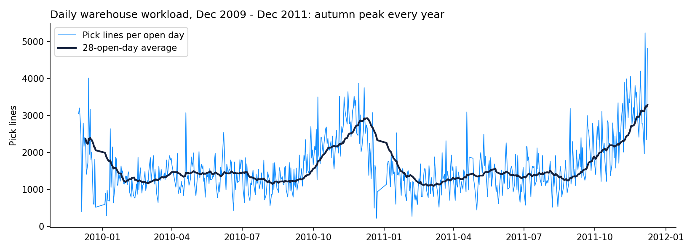

- **603 open days**, averaging **1,661 pick lines** (range 220 – 5,242) and **25.4 lines per order**.
- **Closed** on Saturdays, UK bank holidays, Easter Sunday and 24 Dec – 3 Jan. This rule matches the data on **737 of 738 days**, so future open days are known in advance.
- **Weekly pattern:** Monday busiest (1,901 lines), Sunday quietest (1,330).
- **Seasonal pattern:** an autumn peak every year, e.g. Nov 2011 averaged **3,143** lines/day vs 1,100 – 1,500 in spring.
- **Hourly pattern:** orders arrive 8 AM – 6 PM, peaking at 12 – 1 PM (15% of the day's lines), saved for the simulation step.

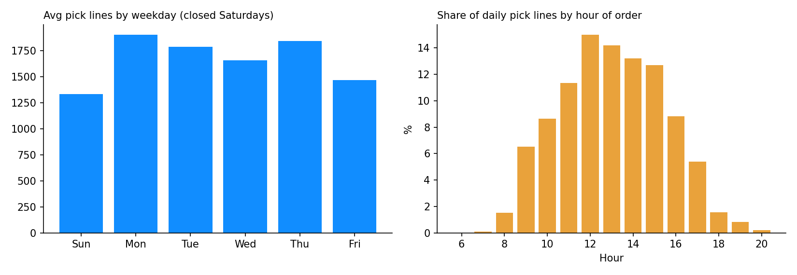

## 3. Forecast model (`src/step3_train.py`, `src/features.py`)

**Features** (all at least 7 days old, so one model covers the whole week): weekday, month, week of year, days to Christmas, first day after a closure, same weekday last week, mean of the last 4 same weekdays, recent 28-day level, trend, same weekday last year, last year's level, year-on-year growth.

**How it was tested**, like real use: at the start of each month the model is retrained on all earlier days, then forecasts that month 7 days ahead.
- **Tuning months:** Jan – Jun 2011. **48 settings** compared (target type, loss, tree size), all logged in **MLflow**.
- **Test months:** Jul – Dec 2011 (137 days, including the autumn peak), scored once.
- Chosen: target = lines ÷ recent 28-day level, squared loss, 7 leaves, 200 trees.

| Method (test months) | Daily WAPE | Bias |
|---|---|---|
| Naive: same weekday last week | 25.6% | −4.8% |
| Mean of last 4 same weekdays | 25.0% | −10.7% |
| Same weekday last year | 23.4% | −10.1% |
| Last year's level × growth | 22.4% | −2.9% |
| **LightGBM (tuned, retrained monthly)** | **22.1%** | −7.5% |

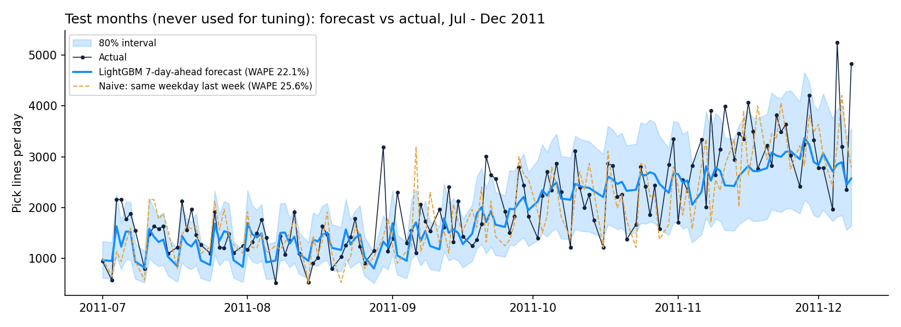

**80% range:** P10 and P90 are the forecast × 0.64 and × 1.38, calibrated on the tuning months only; they contain 80% of test days.

**What drives the forecast (SHAP):** weekday, days to Christmas, same weekday last year, recent level, week of year.

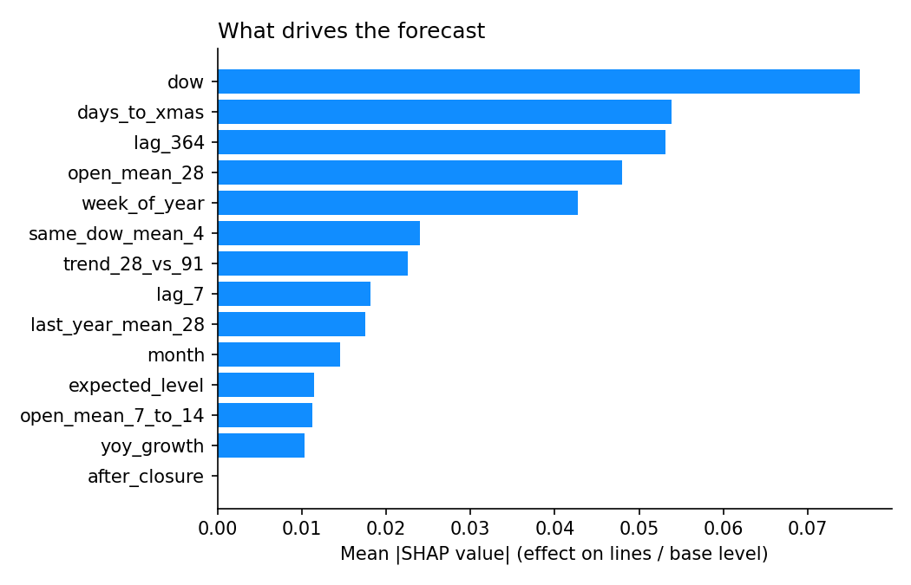

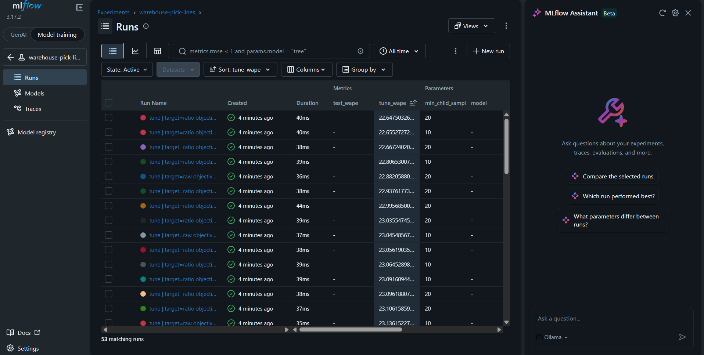

## 4. Staffing rules (`src/step4_staffing.py`)

Each rule sets pickers a week ahead; the real orders then arrive. If the crew falls short, pickers do up to 2 hours of overtime; anything left is picked the next day. Labour cost counts overtime at 1.5×.

| Rule (Jul – Dec 2011) | Avg pickers | Lines picked late | Days with backlog | Labour cost vs flat crew |
|---|---|---|---|---|
| Flat crew (4 pickers, sized on Jan – Jun busy days) | 4.0 | 6.4% | 30 | — |
| Naive: last week's same weekday | 4.2 | 3.4% | 19 | −0.7% |
| Forecast P50 | 4.0 | 2.1% | 14 | **−3.0%** |
| **Forecast P75** | 4.6 | **0.9%** | 7 | +7.7% |
| Forecast P90 | 5.4 | 0.2% | 2 | +21.7% |

The ranking of the rules is the same for pick rates of 60, 80, 100 and 120 lines per hour (`outputs/04_pick_rate_sensitivity.csv`).

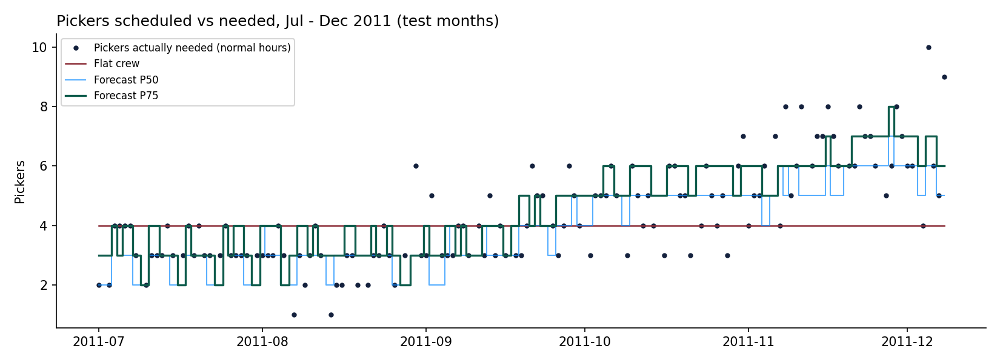

**Assumptions** (`data/raw/staffing_parameters.csv`, all flagged): pick rate 80 lines per picker-hour, 8-hour shift, 85% of the shift spent picking, overtime up to 2 hours at 1.5×. Quoted manual picking rates vary widely (one industry reference gives 60 – 400 picks/hour), so the rate is adjustable in the app and tested across a range.

## 5. Hour-by-hour simulation (`src/step5_simulation.py`, SimPy)

Step 4 sets pickers per **day**, but orders arrive through the day: 16% in the 12 – 1 PM hour, 12% after 4 PM, almost none after 6 PM. A discrete-event simulation (SimPy) replays a busy forecast day, **Mon 12 Dec 2011** (P50 2,423 lines), 300 times per scenario to test **when** pickers should work.

**Model:**
- Day's total lines drawn from the forecast's own uncertainty (lognormal through P10 1,548 and P90 3,346).
- Orders arrive as a Poisson process following the real hourly profile; each order's size is drawn from 7,346 real orders (Sep – Dec 2011, median 16 lines, max 1,112).
- Orders over 40 lines are split into pick tasks (one cart each) so several pickers can work on one order.
- Pickers work first-come-first-served, 80 lines/hour with random variation, 2 min set-up per task, breaks at 2, 4 and 6 hours (15 + 30 + 15 min). Work left at shift end gets up to 2 h overtime; the rest is picked the next day.
- All scenarios use the same 300 random days (separate random streams for demand and pick times), so differences come from the staffing, not luck.
- More pickers stop helping beyond ~6: a large crew finishes early and goes home, so the few orders arriving after 6 PM wait.

| Scenario (300 simulated days each) | Lines picked late | Orders done within 4 h | Overtime (h/day) | Picker utilisation | Labour cost vs all 08 – 16 |
|---|---|---|---|---|---|
| 6 pickers, all 08 – 16 | 9.4% | 90.5% | 5.3 | 56% | — |
| 6 pickers, all 09 – 17 | 4.9% | 94.5% | 3.6 | 61% | −4.6% |
| 6 pickers, all 10 – 18 | 2.1% | 96.3% | 2.4 | 64% | −7.8% |
| 6 pickers, 3 × 08 – 16 + 3 × 10 – 18 | 2.8% | 96.2% | 4.2 | 61% | −2.8% |
| **6 pickers, 3 × 09 – 17 + 3 × 11 – 19** | **1.4%** | 96.9% | 2.9 | 64% | **−6.5%** |
| 5 pickers, all 10 – 18 | 3.5% | 92.7% | 3.6 | 72% | −18.7% |
| 7 pickers, staggered 2 / 3 / 2 from 08 | 2.1% | 97.8% | 3.2 | 55% | +8.6% |

95% confidence intervals are in `outputs/05_simulation_scenarios.csv` (e.g. 9.4% ± 1.0, 1.4% ± 0.4). Late lines count only the part of an order not yet picked.

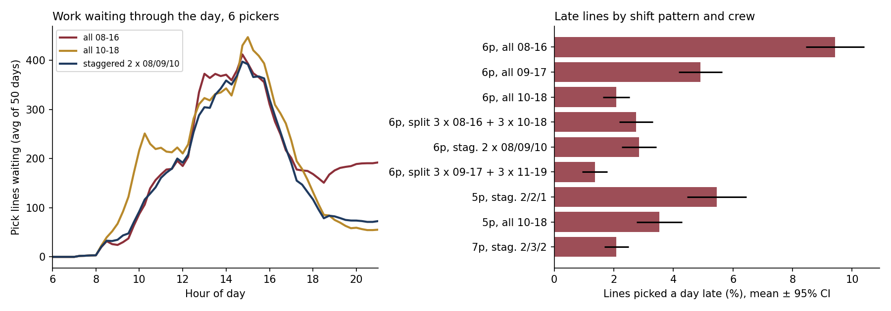

**What it shows:**
1. **Shift timing matters as much as head count.** The same 6 pickers leave 9.4% of lines to the next day on an 08 – 16 shift, because 12% of orders arrive after the crew goes home. Moving the crew to 10 – 18 cuts that to 2.1% and costs 8% less (less overtime).
2. **Best service: split shift 3 × 09 – 17 + 3 × 11 – 19:** 1.4% late, 6.5% cheaper than all-early.
3. **Timing can replace a picker:** 5 pickers on 10 – 18 (3.5% late) do better than 6 pickers on 08 – 16 (9.4%) at 19% lower cost.
4. **The daily plan alone is optimistic:** step 4 assumes work can be done any time in the day. The simulation shows the plan needs a matching shift pattern.

Simulation assumptions (cart size 40 lines, 2 min set-up, pick-time variation 30%) are in `data/raw/simulation_parameters.csv`.

### 5b. Cross-check in Arena (`arena/`, `src/step6_arena_inputs.py`, `src/step7_arena_compare.py`)

The same model was rebuilt in **Rockwell Arena** (Student edition), so that the shift-pattern results do not depend on one piece of code. `step6_arena_inputs.py` turns the SimPy inputs into the numbers typed into Arena (`arena/arena_inputs.csv`): the same lognormal day total, hourly arrival profile, order sizes (17 bins, mean 28.7 vs 28.8 lines), cart size, pick time and breaks. Each scenario was run for 300 days; the reports are in `arena/results/`.

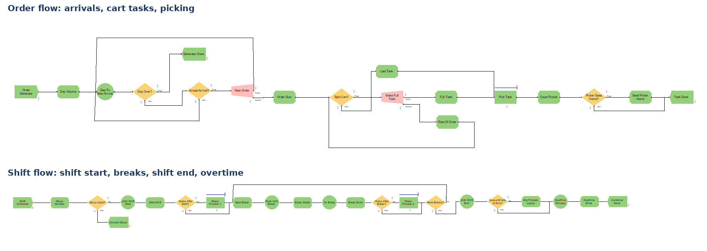

| Scenario (300 days each) | Lines picked late: Arena | Lines picked late: SimPy |
|---|---|---|
| 6 pickers, all 08 – 16 | 9.1% ± 1.0 | 9.4% ± 1.0 |
| 6 pickers, all 10 – 18 | 3.0% ± 0.8 | 2.1% ± 0.5 |
| 6 pickers, 3 × 09 – 17 + 3 × 11 – 19 | 1.5% ± 0.6 | 1.4% ± 0.4 |
| 5 pickers, all 10 – 18 | 3.7% ± 1.0 | 3.5% ± 0.8 |
| 7 pickers, staggered 2 / 3 / 2 from 08 | 2.1% ± 0.6 | 2.1% ± 0.4 |

- **The two models agree:** every pair of 95% confidence intervals overlaps, the scenario ranking is the same (correlation 0.994), and both pick the 09 – 17 / 11 – 19 split as the best pattern.
- **Overtime differs** (Arena 0.9 – 1.6 h/day lower): in Arena the whole crew starts each break at the fixed time; in SimPy each picker first finishes the current cart. Overtime is therefore only compared between scenarios inside one model.
- **Student-edition limit:** Arena Student allows 150 entities at once. A day ends early if more than 120 carts are waiting; this happened on 1 – 4 of 300 days per scenario (the busiest ~1% of days, e.g. 4,911 lines vs a P50 of 2,423). These days are counted in `outputs/07_arena_vs_simpy.csv`.

## 6. API, tests and deployment

| Endpoint | Returns |
|---|---|
| `GET /forecast?days=7&rule=p75&pick_rate=80` | Next 1 – 7 days: pick lines P10 / P50 / P75 / P90 and pickers per day |
| `GET /history?days=90` | Recent actual daily pick lines |
| `GET /backtest` | Test-month forecasts, model comparison, staffing rules |
| `GET /simulation` | Shift-pattern simulation results |
| `GET /model-info` | Features, settings and test scores |
| `GET /health` | Status |

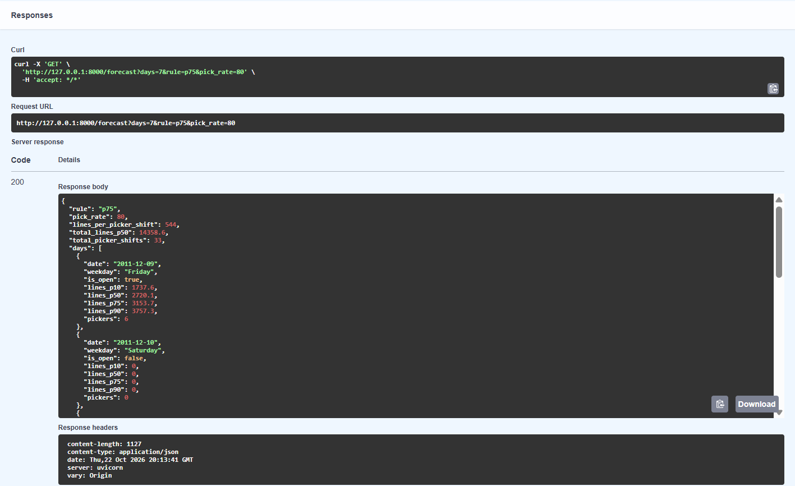

- **FastAPI** with typed responses and input checks (`days` 1 – 7, `rule` p50/p75/p90, `pick_rate` > 0).
- **No LightGBM at runtime:** the trained trees are exported to JSON and scored with numpy (`src/tree_model.py`), which keeps the serverless function small. A test confirms the predictions equal LightGBM's exactly.
- **21 pytest tests:** no look-ahead in the features, the closure rule, every endpoint, bad inputs, JSON model = LightGBM, and simulation checks (every line is picked or late, same days across scenarios, more pickers help when short-staffed).
- **Docker** image and **GitHub Actions** CI: every push runs the tests, builds the image, starts it and calls `/forecast`.
- **Deployed on Vercel:** the API as a Python function (`vercel.json`), the React + Recharts app from `web/` with five tabs: Plan, Accuracy, Staffing rules, Shifts (simulation), About.

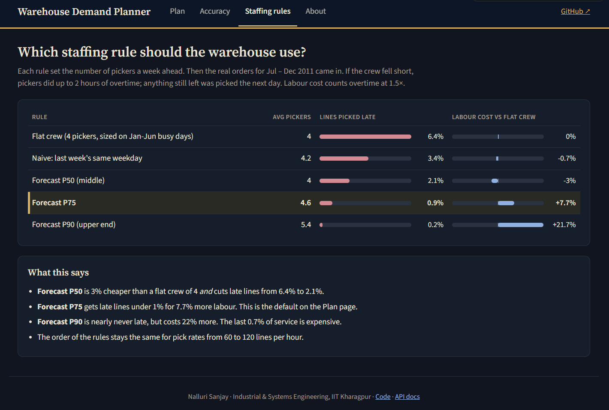

---

## Project structure

```
api/main.py               FastAPI app
src/step1_clean.py        clean the order lines
src/step2_workload.py     daily + hourly workload
src/step3_train.py        baselines vs LightGBM, MLflow, SHAP
src/step4_staffing.py     staffing rules, next-week plan
src/step5_simulation.py   hour-by-hour SimPy simulation of shift patterns
src/step6_arena_inputs.py inputs for the Arena model
src/step7_arena_compare.py Arena vs SimPy comparison
arena/                    Arena model (.doe), its inputs and the 5 scenario reports
src/features.py           features + closure rule (shared by training and API)
src/forecast.py           load model, forecast, pickers (shared)
src/tree_model.py         score the JSON model with numpy
tests/                    pytest
web/                      React app
models/                   LightGBM model (.txt and .json) + model_info.json
data/raw/                 reference CSVs (UCI Excel file not committed)
data/processed/           daily_workload.csv
outputs/                  results and charts
```

## Run it

```bash
# 1. Download online_retail_II.xlsx from UCI into data/raw/
pip install -r requirements-train.txt
python src/step1_clean.py          # ~1 min (reads the Excel file)
python src/step2_workload.py
python src/step3_train.py          # ~1 min; MLflow runs in mlflow.db
python src/step4_staffing.py
python src/step5_simulation.py     # ~20 s
python src/step6_arena_inputs.py   # numbers for the Arena model
python src/step7_arena_compare.py  # after running the scenarios in Arena
python -m pytest -v                # 21 tests

# API
uvicorn api.main:app --reload      # http://127.0.0.1:8000/docs

# Web app (needs Node.js)
cd web && npm install && npm run dev   # set VITE_API_URL in web/.env

# MLflow
mlflow ui --backend-store-uri sqlite:///mlflow.db
```

## Limitations

- **2009 – 2011 data from one wholesaler:** results are historical patterns for this business, not current benchmarks.
- **Pick rate and labour rules are assumptions;** the dataset has no labour data. The ranking of staffing rules holds across 60 – 120 lines/hour.
- **The forecast under-predicts slightly** (bias −7.5% on the test months, mostly in the autumn ramp-up); staffing to P75 absorbs this.
- **Simulation simplifications:** one picking area, first-come-first-served, breaks at fixed times; packing and loading are not modelled. The Arena cross-check uses the Student edition, so the busiest ~1% of days are cut short.
- **Test setup:** an earlier version was tested on Sep – Dec only; the monthly-retraining setup above was chosen after seeing that result. Settings were still chosen on Jan – Jun 2011 only.

---

**Tech:** Python · pandas · LightGBM · MLflow · SHAP · SimPy · Arena · FastAPI · pytest · Docker · GitHub Actions · React · Recharts · Vercel

**Author:** Nalluri Sanjay, B.Tech (Hons.) Industrial & Systems Engineering, IIT Kharagpur · [LinkedIn](https://www.linkedin.com/in/sanjaynalluri2405/) · [GitHub](https://github.com/SanjayNalluri)
